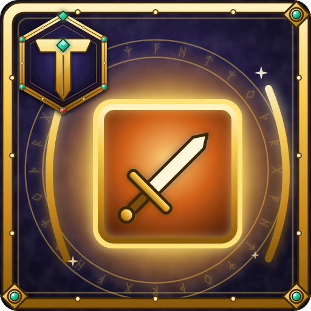

# Tylesser - Proc Glow

A World of Warcraft addon for **WoW Forever** that makes your **action buttons glow when an ability procs**, shows **art beside your character** like later expansions do, and can **play a sound** when a proc starts. It is the proc glow of [Tylesser - Codex](https://tylesser.com/codex/) as an addon of its own, for players who don't use Codex.

## Features

- **Reactive abilities glow** while they can be used: Overpower, Revenge, Execute, Riposte, Counterattack, Mongoose Bite, Hammer of Wrath (and Victory Rush where the game has it).
- **Buff procs glow** the spells they empower: Shadow Bolt with Shadow Trance (Nightfall), Arcane Missiles with Missile Barrage, Pyroblast at 3 stacks of Heating Up, the paladin's seals with Unsealed Wrath's echoes at 3 stacks. Clearcasting shows only its art, no glow on the buttons.
- What the game already lights itself keeps the game's glow.
- **Glow styles**: the game's spell alert, a pulsing border, marching sparkles, a soft glow, a flash or a ring, with a preview. Colour (gold, class or a fixed colour), pulse speed and thickness.
- **Cooldown manager**: the glow on its icons too, and optionally in place of the game's square glow.
- **Art beside your character**: a piece drawn for each proc, the game's own art, the spell's icon or a plain arc. Several procs show together: two left and right, a third on top, a fourth below. Size and opacity, with "Show the art" and "Show all arts".
- **Sound** when a proc starts (off until you switch it on): 14 of the game's sounds, soft or loud, only in combat if you like, on the Master channel if you want, and a different sound per ability.

If you use Codex, its own proc glow does the same; while this addon is loaded, Codex leaves the job to it.

## Usage

- Esc > Options > AddOns > **Tylesser - Proc Glow**, or `/procglow`.
- `/procglow test` shows the art for a few seconds, `/procglow arts` every piece of art.
- `/procglow on` / `/procglow off` switches it.
- `/procglow report` prints what each glow is doing (handy in a bug report).

In combat the game hides most of your buffs from addons. Buff procs then light only while that buff is tracked in the game's cooldown manager, which Proc Glow can still read.

## Feedback

Found a bug or have an idea? Click **Feedback** on the options page or type `/procglow feedback` in game to get the link, or go straight to [tylesser.com/feedback](https://tylesser.com/feedback/#procglow).

No GitHub account? Join the [Tylesser Discord](https://discord.gg/n2rEB6mRxF) and post in #bug-reports or #ideas with the addon's tag; each post is copied to GitHub and the bot answers with the link.

## Installation

Install from CurseForge or Wago, or download the latest zip from [Releases](https://github.com/Tylesser/ProcGlow/releases) and extract it to `Interface/AddOns`. The folder must be named `ProcGlow`.

## Releasing (maintainers)

Releases are built by [BigWigsMods/packager](https://github.com/BigWigsMods/packager). Push a version tag to publish to GitHub Releases, CurseForge and Wago Addons:

```
git tag v1.0.0
git push origin v1.0.0
```

## License

[MIT](LICENSE)
